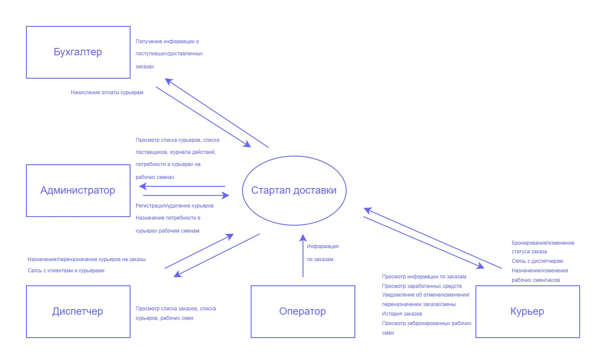

# Документ о концепции и границах. Приложение для службы доставки "Грядка"

## Раздел 1. Введение.

### 1.1. Назначение документа.

Данный документ предназначен для:

- Команды разработчиков - для понимания бизнес-требований и архитектурных решений
- Инвесторов и стейкхолдеров - для оценки бизнес-потенциала проекта
- Руководства проекта - для принятия стратегических решений

### 1.2. Цель и область применения.

Документ определяет бизнес-требования к приложению для службы доставки "Грядка".

Область применения: Автоматизация полного цикла доставки - от приема заказа до финального расчета с участниками процесса.

### 1.3. Исполнители.

Команда разработчиков: не назначена; 
Команда аналитиков: Ласукова Анета, Мозговая Юлиана.

## Раздел 2. Исходная информация.

### 2.1. Список источников информации.

1. Федеральный закон "О персональных данных" от 27.07.2006 N 152-ФЗ  - регулирует обработку персональных данных клиентов и сотрудников. [Электронный ресурс]. URL: https://www.consultant.ru/document/cons_doc_LAW_61801/
2. Федеральный закон "О национальной платежной системе" от 27.06.2011 N 161-ФЗ - регулирует прием онлайн-платежей и работу с платежными шлюзами. [Электронный ресурс]. URL: https://www.consultant.ru/document/cons_doc_LAW_115625/
3. Закон РФ от 07.02.1992 N 2300-1 (ред. от 28.12.2025, с изм. от 17.02.2026) "О защите прав потребителей" (с изм. и доп., вступ. в силу с 01.04.2026) - регулирует отношения с клиентами при оказании услуг. [Электронный ресурс]. URL: https://www.consultant.ru/document/cons_doc_LAW_305/
7. Delivery Club. Официальный сайт сервиса доставки еды. [Электронный ресурс]. URL: https://delivery-club.ru/
8. Яндекс Еда. Официальный сайт сервиса доставки. [Электронный ресурс]. URL: https://eda.yandex.ru/
9. Купер (ex-СберМаркет). Официальный сайт сервиса доставки продуктов. [Электронный ресурс]. URL: https://kuper.ru/
10. Достависта. Сервис курьерской доставки для бизнеса. [Электронный ресурс]. URL: https://dostavista.ru/
15. Яндекс.Доставка для бизнеса. Возможности и тарифы. [Электронный ресурс]. URL: https://delivery.yandex.ru/
9. Вигерс К., Битти Дж. Разработка требований к программному обеспечению :учебник / К. Вигерс, Дж. Битти. – 3-е изд., доп. – М. : BHV, 2024.
10. BABOK. Руководство к Сводy знаний по бизнес-анализу / под ред. IIBA ; пер. с англ. – М. : ООО Олимп-Бизнес, 2021
11. Леффингуэлл, Д. Принципы работы с требованиями к программному обеспечению: унифицированный подход / Д. Леффингуэлл, Д. Уидриг. – М.: Вильямс, 2002. 
12. Кейнер, С. Руководство фасилитатора: как привести группу к принятию совместного решения / С. Кейнер, Л. Линд, К. Толди, С. Фиск, Д. Бергер. – М.: Издательство Дмитрия Лазарева, 2013.
13. Корнипаев, И. Требования для программного обеспечения:рекомендации по сбору и документированию / И. Корнипаев. – М.: Книга по требованию, 2026.

### 2.2. Список сокращений и глоссарий.

- MVP - Minimum Viable Product, минимально жизнеспособный продукт;
- API - Application Programming Interface, интерфейс программирования приложений;
- CRM - Customer Relationship Management, система управления отношениями с клиентами;
- AS IS - текущее состояние процессов до внедрения системы;
- TO BE - целевое состояние процессов после внедрения системы;

### 2.3.Глоссарий.

- Онлайн-запись - функция бронирования времени у конкретного мастера через приложение;
- Слот - доступный интервал для записи (например, 11:00-11:45);
- Push-уведомление - напоминание о записи, отправляемое клиенту в приложении;
- 1С - программная платформа для автоматизации учета; 

### 2.4. Список заинтересованных сторон.

| Идентификатор | Заинтересованная сторона | Описание | Уровень влияния на систему |
|:-------------:|--------------------------|----------|:--------------------------:|
| st001 | Собственник | Владеет бизнесом, инвестирует в развитие, принимает стратегические решения | Высокий |
| st002 | Поставщик | Поставляет товары для доставки, обеспечивает наличие продукции | Средний |
| st003 | Администратор системы | Управляет правами доступа, настраивает параметры системы | Средний |
| st004 | Оператор | Передает заказы от поставщиков в систему | Средний |
| st005 | Диспетчер | Распределяет заказы между курьерами, контролирует выполнение | Высокий |
| st006 | Курьер | Доставляет заказы, взаимодействует с получателями | Высокий |
| st007 | Разработчик приложения | Создает и поддерживает функционал системы, вносит изменения | Высокий |
| st008 | Получатель | Заказывает услуги доставки у поставщика, оплачивает сервис | Средний |
| st009 | Бухгалтер | Ведет финансовый учет, составляет отчетность | Средний |
| st010 | Регулятор | Устанавливает требования и нормы для системы доставки | Высокий |
| st011 | HR | Подбирает персонал, управляет кадровыми вопросами | Низкий |
| st012 | Конкурент | Другая служба доставки, конкурирующая за клиентов и рынок | Высокий |
| st013 | Служба технической поддержки | Помогает пользователям решать технические проблемы | Низкий |
| st014 | Менеджер | Работает с клиентами, решает вопросы обслуживания | Средний |
| st015 | Сборщик | Комплектование заказов перед доставкой | Низкий |

## Раздел 3. Бизнес-требования.

### 3.1. Проблемы, которые решит система.

1. Упростить работу с заказами
2. Наладить систему расчетов
3. Выделиться среди конкурентов
4. Подготовиться к расширению компании
5. Расширить выбор для клиентов

### 3.2. Предусловия, окружение, ситуация.

На данный момент компания находится на стадии запуска, бизнес-процессы не формализованы. Разрабатываемая система критически важна для работы компании — без неё невозможно организовать процесс доставки.

Пандемия COVID-19 существенно изменила рынок доставки продуктов, многократно увеличив спрос на эти услуги, который остаётся стабильно высоким.

Сейчас на рынке доминируют B2C-сервисы (ориентированные на конечных клиентов), такие как «Купер», Delivery Club, «Яндекс.Еда». Их модель работает так: клиент выбирает товары в приложении, а сервис передаёт заказ поставщику.

Наша система реализует B2B-модель (работа с бизнесом). Мы выступаем оператором доставки, сотрудничая напрямую с поставщиками и получая заказы от них. Этот сегмент рынка менее насыщен, конкуренция здесь значительно ниже, чем среди сервисов доставки для частных клиентов.

Ключевые игроки в сегменте B2B-доставки: «Достависта», «Курьер Сервис Экспресс», «Яндекс.Доставка» для бизнеса.

### 3.3. Возможности системы.

1. Централизованная система приема и обработки заказов
2. Геолокация курьеров
3. Автоматизированные уведомления всех участников
4. Автоматический расчет комиссий и выплат
5. Интеграция с банковскими системами и бухгалтерией
6. Прозрачная система финансовой отчетности
7. Соответствие требованиям налогового законодательства
8. Удобное мобильное приложение для всех ролей и права доступа

### 3.4. Бизнес-цели.

Создание эффективной системы для автоматизации процессов доставки, обеспечивающей конкурентоспособность компании на рынке.

1. Снижение количества ошибок в заказе до 5%
2. Уменьшить время доставки до 30 минут
3. Увеличение прибыли на 10% за 3 месяца
4. Расширение базы поставщиков до 10 за 6 месяцев
5. Увеличить количество курьеров в базе до 50 человек за 1 год
6. Внедрить круглосуточную обработку заказов

## Раздел 4. Границы проекта

### 4.1.Основные роли системы и их функции.

| Идентификатор | Роль | Действия в системе |
|:-------------:|:-----------------------:|-------------------|
| st001 | Собственник | Не участвует |
| st002 | Поставщик | Не участвует |
| st003 | Администратор системы | - Просмотр списка курьеров - Просмотр личных данных курьеров - Просмотр списка поставщиков - Просмотр потребностей в курьерах на рабочие смены - Просмотр журнала действий - Просмотр расписания работы курьеров |
| st004 | Оператор | - Просмотр информации по заказам - Передача информации по заказам |
| st005 | Диспетчер | - Просмотр списка заказов - Назначение/переназначение курьеров на заказы - Просмотр списка курьеров - Связь с клиентами и курьерами - Просмотр рабочих смен и назначенных на них курьеров - Изменение статуса заказа |
| st006 | Курьер | - Просмотр информации по заказам - Бронирование/изменение статуса заказа - Просмотр заработанных средств - Связь с диспетчером - Уведомление об отмене/изменении/переназначении заказа/смены - Назначение/изменение рабочих смен - Просмотр истории заказов - Просмотр забронированных рабочих смен |
| st007 | Разработчик приложения | Не участвует |
| st008 | Получатель | Не участвует |
| st009 | Бухгалтер | - Получение оперативного расчета за доставку |
| st010 | Регулятор | Не участвует |
| st011 | HR | Не участвует |
| st012 | Конкурент | Не участвует |
| st013 | Служба технической поддержки | - Общение с сотрудниками |
| st014 | Менеджер | - Просмотр списка заказов - Просмотр списка курьеров - Связь с получателями и курьерами - Просмотр рабочих смен и назначенных на них курьеров|
| st015 | Сборщик | Не участвует |

*Рис. 1 . Контекстная диаграмма.*

### 4.2. Функции, выходящие за границы системы.

- Персонализированные рекомендации товаров для клиентов;
- Интеграция с внешними бонусными и скидочными программами поставщиков;
- Автоматическая сдача налоговой и бухгалтерской отчетности;
- Онлайн-консультации с поставщиками;
- Автоматический заказ расходных материалов для курьеров;
- Управление складскими остатками товаров у поставщиков;
- Физическая сборка и упаковка заказов;
- Междугородняя и международная логистика;
- Обработка возвратов товаров поставщикам;
- Ценообразование и установка скидок на товары;
- Полный кадровый учёт сотрудников (трудовые договоры, отпуска, больничные);
- Маркетинговые рекламные кампании и продвижение;
- Встроенный корпоративный мессенджер для сотрудников.

---

*Документ подготовлен командой бизнес-аналитиков: Юлиана Мозговая, Ласукова Анета.* 
*Дата создания: 26.07.2026 г.* 
*Версия: 1.0*